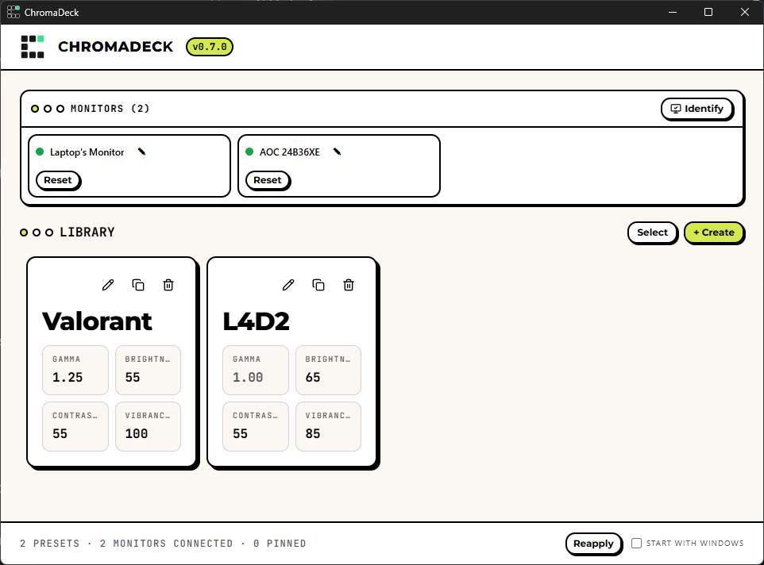

# ChromaDeck

Per-monitor display color profile manager for Windows. Save color presets — brightness, contrast, gamma, RGB gains, saturation, digital vibrance, hue, and ICC profiles — and apply, pin, or enforce them per monitor from a single deck-style UI. Your displays, your colors: one editor for every GPU vendor, with the hardware differences handled underneath.



## Features

- **Global presets, per-monitor pins** — presets are monitor-agnostic and apply to any display (identified by EDID, stable across docking, reconnects, and reboots); pin one preset per monitor for enforcement. Monitors are user-renamable.
- **Empty by default** — fresh installs start with an idle library: no seeded preset, nothing pinned or applied. (Upgrades run a one-shot purge of pristine seeded Standard installs; user-tweaked presets are never touched.)
- **One editor, every vendor** — the same preset editor drives NVIDIA, Intel, and basic displays; per-slider availability is reported from the display's actual capabilities, not guessed from the GPU model. The editor stays ungated — the Apply dialog reports which adjustments the chosen display supports, with the reason, before you apply.
- **Vendor-aware color engine** — brightness/contrast/gamma use NVIDIA's own transfer math and driver API where an NVIDIA display is targeted (results match the NVIDIA Control Panel exactly), Intel's IGCL pixel-transformation pipeline where the display is Intel-driven, and a universal GDI fallback everywhere else. The backend is chosen per physical display, so hybrid-graphics laptops route their internal panel and external monitors independently.
- **Digital vibrance & hue** — driven through the NVIDIA driver (same control as NVCP), with per-display support detection. Saturation (0–100, neutral 50) is the vendor-neutral colour-intensity control and is available on Intel displays.
- **ICC profiles** — bundle `.icc`/`.icm` files into presets and associate them per monitor.
- **Pin & enforce** — pin a preset per monitor; on NVIDIA displays a background loop restores it if anything (games, HDR toggles, driver updates) stomps it. Intel pins are recorded and shown but are not auto-reapplied (see Display support). Tray-resident with autostart and single-instance.
- **Reset, duplicate, delete** — full-default reset (gamma + vibrance + hue), one-click duplicate, delete with confirmation.
- **Import NVCP state** — capture the driver's live color state straight into a new preset.
- **Preset deck UI** — light neobrutalist theme: paper background, black borders, hard offset shadows, mint accent fills, tap-to-apply deck, in-use highlighting on preset cards, monitor sidebar, support for offline monitors.
- **Tray-native window** — closing hides to the tray; every re-open (tray Show, tray click, second launch) replays the staged load animation; the window spawns centered on launch.

## Installation (Windows 10/11 x64)

Download from the [releases page](https://github.com/miiidev/ChromaDeck/releases) or build it yourself:

| File | What it is |
|---|---|
| `ChromaDeck_*_x64_en-US.msi` | Standard Windows installer (recommended) |
| `ChromaDeck_*_x64-setup.exe` | NSIS setup wizard |
| `ChromaDeck_*_x64-portable.zip` | Portable ZIP (exe + license + marker, unzip and run — settings stay in a `data` folder next to the exe, nothing in AppData) |
| `chromadeck.exe` | Standalone binary, no install needed |

Requirements: Windows 10/11 x64 and the WebView2 runtime (preinstalled on Windows 10 1809+ and Windows 11). NVIDIA displays unlock the NVCP-native engine plus digital vibrance/hue; Intel-driven displays use the Intel IGCL pipeline (saturation, hue, gamma family); any other display falls back to OS-level color controls where supported.

## Display support

Which adjustments are available depends on the display you target, not on the GPU model — the editor queries each display and reports the truth:

| Adjustment | NVIDIA (NVAPI) | Intel (IGCL) | Basic (GDI) |
|---|---|---|---|
| Gamma | ✓ | ✓ | ✓ |
| Brightness | ✓ | ✓ | ✓ |
| Contrast | ✓ | ✓ | ✓ |
| RGB gains | ✓ | ✓ | ✓ |
| Saturation | — | ✓ | — |
| Digital vibrance | ✓ | — | — |
| Hue | ✓ | ✓ | — |

Known limitations, stated plainly:

- **HDR** — when a display has HDR enabled (read from the driver's enabled flag, not merely HDR support), per-display color adjustments are reported unsupported rather than silently misapplied. Use SDR mode for preset work.
- **Exclusive-fullscreen games** — best effort. Driver-level (NVAPI) settings commonly hold through fullscreen; the GDI fallback can be bypassed by exclusive fullscreen. The enforcement loop re-applies on drift where it can detect it.
- **Intel restore** — Intel reset restores the panel to the state captured before ChromaDeck's own apply in this session, verified by read-back. With no such capture, reset reports an honest failure instead of a false success; a reboot returns the panel to the driver's own default.
- **Intel pins are not auto-enforced** — the background drift loop and startup re-apply deliberately skip Intel displays (their colour lives in a runtime-only driver LUT that Reset depends on capturing). A pin still records intent and enables **Apply…**; use **Reapply** after an external change.
- **Apply verification** — apply reports which adjustments were written, skipped, or failed, and marks writes as accepted-by-driver but not read-back-verified. The sidebar **Probe** is the read-back check.
- **AMD** — not yet implemented. AMD displays fall back to the basic GDI engine; the backend interface has a slot for a future AMD implementation.

## Usage

1. Launch ChromaDeck — the sidebar lists your monitors (connected, plus last-known offline ones); the library deck below holds your presets. Fresh installs start empty: click **+ Create** (or **Create preset** in the empty state) to build your first preset — name it, tweak sliders, optionally attach an ICC profile, capture the live NVCP state, or set a color tag.
2. Click a preset pad (or **Apply…** on a monitor's pinned preset) to open the Apply dialog: pick the target monitor (your last target per preset is remembered), optionally toggle **Pin**, then **Apply**.
3. A pinned preset stays enforced on NVIDIA displays — the background loop restores it if games, HDR toggles, or driver updates stomp it. Intel pins are not auto-reapplied; use **Reapply** after an external change (see Display support). Cards show **IN USE** while pinned or applied on a connected monitor.
4. Manage each monitor from the sidebar: **✎** renames it, **Reset** returns it to defaults (and unpins it once the restore succeeds), **Unpin** releases a pin. **Identify** flashes every monitor's number on screen. **Probe** reads back live hardware state (engine, vibrance, ramp peak) without changing anything — the answer to "did it land?".
5. Manage the library from the deck toolbar: pencil edits, copy duplicates, trash deletes (with confirmation); **Select** enables multi-delete. The footer shows preset/monitor/pin counts plus **Reapply** and the **Start with Windows** toggle.
6. Closing the window hides it to the tray — right-click the tray icon for Show / Reapply now / Quit, or left-click to reopen.

All values show their neutral points in the editor (e.g. brightness/contrast 50, gamma 1.0): a fresh preset changes nothing until you move a slider.

## Troubleshooting

**A monitor still looks wrong after Reset.** Reset restores driver gamma/vibrance to neutral and verifies by read-back — if it reports an error, that text names the stuck part. If it reports success but the panel looks off, something below the app owns the look:
- Reboot. Clears OS ramps; if the wrong look *returns*, it's persisted at driver level.
- NVIDIA Control Panel → Adjust desktop color settings → select the display → Restore defaults (or Intel Graphics Command Center / AMD Software → restore defaults).
- Windows Settings → System → Display (per display): Night Light off, HDR off.
- In-game video settings and OEM display apps (PremierColor, LegionZone, …) override everything silently.
- The sidebar **Probe** button reads live hardware state without changing anything — if it disagrees with Reset's report, that's the lead.
- Note: Reset never removes ICC profile associations (by design); remove those in Windows Color Management if a preset installed one.

## How it works

- **Frontend:** React + Vite + Tailwind CSS v4, light neobrutalist theme (paper, black borders, hard shadows, mint accent fills; see `DESIGN.md`).
- **Backend:** Rust via Tauri v2. `monitor.rs` enumerates displays as an adapter→monitor tree with EDID identity; `store.rs` persists presets/pins/aliases as JSON; `backend/` holds the vendor-neutral `ColorBackend` interface with its NVIDIA (`nvapi`), Intel (`intel`, dynamic-loaded IGCL), and universal GDI implementations, selected per display; `capabilities.rs` reports per-adjustment availability to the editor; `color.rs` orchestrates ICC + backend apply; `nvgamma.rs` + `nvapi.rs` implement the NVCP transfer math (reimplemented from observed driver behavior), 1024-entry float ramps, and driver-registry persistence; `enforce.rs` runs startup re-apply, the 10-second drift-check loop, and exit classification; `identify.rs` spawns numbered overlay windows for monitor identification.
- **Data lives in** `%LOCALAPPDATA%\ChromaDeck\` (`presets.json`, `pins.json`, `applied.json`, `monitor_names.json`, `profiles\`, plus timestamped `.bak-*` backups before migrations). The portable ZIP keeps data in a `data` folder next to the exe instead (via its marker file); setting `CHROMADECK_DATA_DIR` overrides the location entirely.

## Development

Prerequisites: Node.js 20+, Rust stable toolchain.

```powershell
npm install          # frontend deps
npm run tauri dev    # dev app with hot-reload
```

Verification (all must pass):

```powershell
npx tsc --noEmit                                # typecheck
npm test                                        # frontend tests (vitest)
cargo test --manifest-path src-tauri/Cargo.toml # backend tests
npm run tauri build                             # release bundles -> src-tauri/target/release/bundle/
npm run bundle:portable                         # portable ZIP (after tauri build)
```
(All commands run from the repo root.)

Project layout:

```
src/                    # React frontend (App, components, lib)
src-tauri/src/          # Rust backend (backend/, capabilities, monitor, store, color, nvapi, nvgamma, enforce)
docs/superpowers/       # design specs + implementation plans
docs/screenshots/       # README images
```

## Acknowledgements

- [nvBrightness](https://github.com/pbatard/nvBrightness) by Pete Batard — behavioral reference for NVIDIA's brightness transfer math (reimplemented, no code reused).
- [NvAPIWrapper](https://github.com/falahati/NvAPIWrapper) — reference for NVAPI interface IDs.
- [Intel Graphics Control Library](https://github.com/intel/drivers.gpu.control-library) — public SDK header used for the transcribed IGCL struct definitions (see [NOTICE](NOTICE)).
- Built with [Tauri](https://tauri.app/), React, and Tailwind CSS.

## License

MIT — see [LICENSE](LICENSE). (Default choice; say the word if you'd rather ship another license.)
